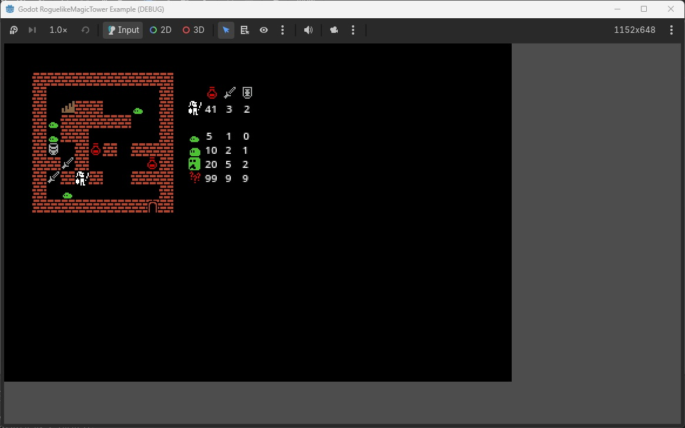

# Godot RoglikeMagicTower Example

A simple rogue-like magic tower game developed using Godot.

## Features
* Map: obstacles, items, monsters, stairs
* Player: move, pick up, fight
* Simple UI and animations
* TODO:
  - Endless mode

## About
* Program: Snowy
* Art: Way, vurmux (Urizen 1Bit Tileset)
* Music: Abstraction
* Sound Effects: JDWasabi

## LICENSE
* Project: GPL-3.0 (Snowy)
* Assets:
  - [coming soon] *princess.png*, *princess1.png*: CC-BY-SA-4.0 (Way)
  - [coming soon] *fragment1.png*: CC-BY-SA-4.0 (Way)
  - Music (*.ogg*): <https://tallbeard.itch.io/three-red-hearts-prepare-to-dev>
  - Sound Effects (*.wav*): <https://jdwasabi.itch.io/8-bit-16-bit-sound-effects-pack>
  - Others: CC0
